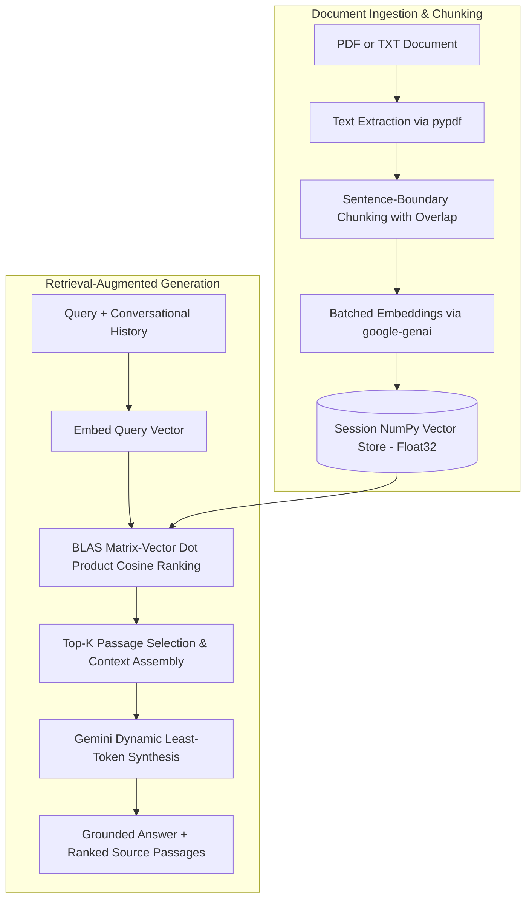

# Ask Your Documents (RAG with Gemini)

Upload a PDF or text file and ask questions about it. Answers come directly from your document, and every answer cites the source passages it was grounded in.

**Live demo:** [rag.anandpabbineedi.site](https://rag.anandpabbineedi.site)


> The backend runs on a free cloud instance, so the initial cold-start request can take up to a minute while it wakes up.

## Features

- **Answers with source citations:** Every answer expands to show exact passages retrieved from the document, highlighted with file name and cosine similarity score.
- **Context-aware follow-up queries:** Maintains recent conversational turns in both vector retrieval query construction and LLM context synthesis.
- **Session-isolated storage:** Per-session vector isolation ensures multi-tenant privacy.
- **Robust document parsing:** PDF and TXT support powered by `pypdf`, with error handling for encrypted/password-protected files, empty files, scanned files, and oversized documents.
- **Resilient model fallback:** Proactive dynamic least-token model fallback against Google GenAI 503 capacity spikes and 429 quota limits.

## Architecture & How It Works

Retrieval is engineered in Python with FastAPI and vectorized NumPy:



1. **Sentence-Aware Chunking:** Text is split into ~1,500-character windows with 200-character overlap, strictly respecting punctuation boundaries (`.`, `!`, `?`, `\n`) to preserve semantic coherence.
2. **Batched Embeddings:** Document chunks are embedded in batches of 50 via `text-embedding-004` (or `gemini-embedding-001`) at 768 dimensions using the official `google-genai` SDK.
3. **Pre-Normalized Vector Store:** Embeddings are cast to IEEE-754 `float32` and normalized to unit length ($L_2$ norm) upon ingestion.
4. **Vectorized Retrieval:** The query (and prior conversational turn) is embedded, normalized, and compared against session documents using an ultra-fast NumPy matrix-vector dot product ($S = M \cdot q$).
5. **Generation & Fallback:** Small documents ($\le 8$ chunks) feed full context; larger documents supply top-4 chunks. Synthesized through dynamic least-token model fallback (`gemini-2.5-flash`, `gemini-2.0-flash`, `gemini-1.5-flash`).

## Engineering Decisions

| Decision | Rationale |
|---|---|
| **FastAPI + Pydantic v2** | High-throughput asynchronous ASGI backend with compile-time-speed request validation, OpenAPI schema generation, and strict type safety. |
| **Vectorized NumPy (No external vector DB)** | For hundreds of document chunks per session, an external vector DB introduces unnecessary network hops and infrastructure overhead. NumPy pre-normalized matrix dot products execute in sub-millisecond BLAS routines. |
| **Pre-Normalized $L_2$ Unit Vectors** | By normalizing vectors during insertion ($\mathbf{v} / \|\mathbf{v}\|_2$), cosine similarity simplifies from $\frac{\mathbf{u} \cdot \mathbf{v}}{\|\mathbf{u}\|\|\mathbf{v}\|}$ to a single dot product $\mathbf{u} \cdot \mathbf{v}$, avoiding repeated square-root calculations at query time. |
| **Batched Embeddings** | Sequential chunk embedding exhaust API rate limits quickly. Batching into 50 chunks per API call reduces network overhead by 50x and stays well within rate quotas. |
| **Dynamic Least-Token Fallback** | Production LLM APIs face capacity spikes (HTTP 503) and quota caps (HTTP 429). The backend automatically ranks discovered models by token footprint and gracefully cascades through fallback candidates before failing. |
| **Sliding-Window Rate Limiting** | In-memory sliding-window limiters guard against abuse on public endpoints (per-session and global daily thresholds). |

## Tech Stack

- **Backend:** Python 3.12+, FastAPI, Uvicorn, Pydantic v2, Pydantic-Settings
- **Data & Parsing:** NumPy, `pypdf`, `python-multipart`
- **AI / LLM:** Google GenAI SDK (`google-genai`)
- **Testing:** Pytest, HTTPX / Starlette TestClient
- **Frontend:** HTML5, Modern CSS, Vanilla JavaScript, Marked.js, DOMPurify
- **DevOps:** Docker, Docker Compose, Render PaaS

## API Reference

All `/api/*` endpoints require the `X-Session-ID` header (8 to 64 alphanumeric characters or hyphens).

| Method | Endpoint | Request Payload | Response |
|---|---|---|---|
| `POST` | `/api/upload` | Multipart `file` (PDF/TXT, max 5 MB) | `{"fileName": str, "chunksCreated": int}` |
| `POST` | `/api/ask` | `{"question": str, "history": [{"role": str, "text": str}]}` | `{"answer": str, "sources": [{"fileName": str, "excerpt": str, "score": float}], "_modelUsed": str}` |
| `DELETE` | `/api/session` | None | `{"cleared": true}` |
| `GET` | `/` | None | Health check `{"status": "ok", "service": "rag-gemini-chatbot"}` |

## Run Locally

### Prerequisites
- Python 3.11+
- Google Gemini API key ([Google AI Studio](https://aistudio.google.com/))

### 1. Backend Setup

```bash
cd backend

# Create virtual environment
python -m venv .venv

# Activate environment
# On Linux/macOS:
source .venv/bin/activate
# On Windows:
.venv\Scripts\activate

# Install dependencies
pip install -r requirements.txt
```

Create `backend/.env` (or copy `backend/.env.example`):

```env
GEMINI_API_KEY=your_gemini_api_key_here
GEMINI_MODEL=gemini-2.5-flash
GEMINI_EMBED_MODEL=text-embedding-004
ALLOWED_ORIGINS=http://localhost:5500,http://127.0.0.1:5500
```

Start the FastAPI application:

```bash
uvicorn app.main:app --host 0.0.0.0 --port 3000 --reload
```

Run test suite:

```bash
pytest -v
```

### 2. Frontend Setup

Set `API_BASE_URL` in `frontend/script.js` to `http://localhost:3000/api`, then serve the frontend folder:

```bash
# Using python built-in server or npx serve
npx serve -l 5500 frontend
# or
python -m http.server 5500 --directory frontend
```

Navigate to `http://localhost:5500`.

### 3. Running with Docker Compose

```bash
docker compose up --build
```

## Configuration

| Environment Variable | Default | Purpose |
|---|---|---|
| `GEMINI_API_KEY` | *(Required)* | Google AI Studio API key |
| `GEMINI_MODEL` | `gemini-2.5-flash` | Preferred answer generation model |
| `GEMINI_EMBED_MODEL` | `text-embedding-004` | Embedding model for semantic search |
| `ALLOWED_ORIGINS` | `http://localhost:5500` | CORS permitted origins |
| `UPLOADS_PER_HOUR` | `10` | Max document uploads per session/hour |
| `QUESTIONS_PER_HOUR` | `30` | Max queries per session/hour |
| `DAILY_UPLOADS` | `100` | Global daily upload cap |
| `DAILY_QUESTIONS` | `300` | Global daily question cap |
| `PORT` | `3000` | Service port |

## Testing

The project includes integration tests covering document ingestion, mock vectorized retrieval, session clearing, and input validation:

```bash
cd backend
pytest -v
```

## Author

Built by [Anand Pabbineedi](https://anandpabbineedi.site) • [LinkedIn](https://www.linkedin.com/in/anand-pabbineedi-6b3b93257/)
