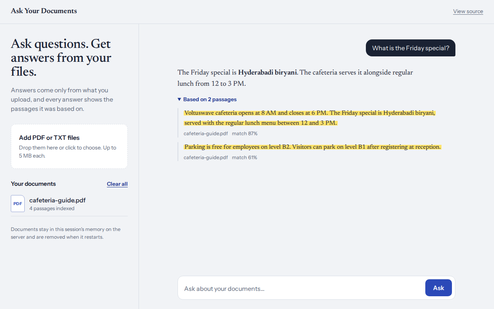
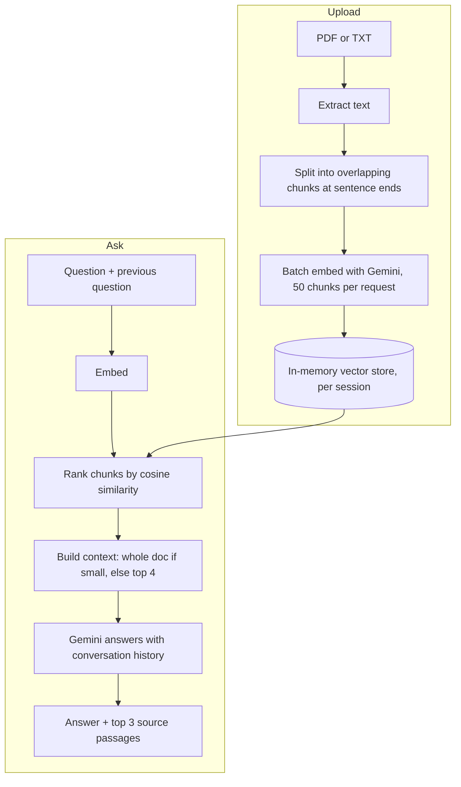

# Ask Your Documents (RAG with Gemini)

Upload a PDF or text file and ask questions about it. Answers come only from your document, and every answer shows the passages it was based on.

**Live demo:** [rag.anandpabbineedi.site](https://rag.anandpabbineedi.site)



> The backend runs on a free server, so the first request can take up to a minute while it wakes up.

## Features

- **Answers with sources.** Every answer can expand to show the exact passages it used, highlighted, with the file name and match score.
- **Follow-up questions.** Ask "what about the second point?" and it understands, because recent conversation turns feed into both retrieval and the prompt.
- **Private sessions.** Each browser only searches its own documents.
- **PDF and TXT support** with clear messages for scanned PDFs, password-protected files, empty files, and documents that are too long.

## How it works

Retrieval is built from scratch, without a vector database.



1. **Chunking:** text is split into chunks of about 1,500 characters with 200 characters of overlap, breaking at sentence ends where possible so ideas aren't cut mid-sentence.
2. **Embedding:** chunks are embedded with `gemini-embedding-001` in batches of 50, at 768 dimensions.
3. **Storage:** vectors are kept as `Float32Array`s in a per-session in-memory store.
4. **Retrieval:** the question (plus the previous question, for follow-ups) is embedded and compared to every chunk with cosine similarity.
5. **Generation:** small documents (8 chunks or fewer) go to Gemini whole; larger ones send the top 4 chunks. The top 3 are returned as sources.

## Engineering decisions

| Decision | Why |
|---|---|
| No vector database | For a few hundred chunks per session, brute-force cosine similarity is fast and has zero infrastructure. At millions of vectors, an approximate index (FAISS, HNSW, pgvector) would be the right call. |
| Batched embeddings | The first version made one API call per chunk and hit Google's free-tier limit of 100 requests per minute on a single book. Batching cut API calls 50x. |
| 768-dim `Float32Array` vectors | Default 3,072-dim vectors stored as JS numbers take about 24 KB each. 768-dim Float32 takes 3 KB, an 8x saving that keeps the store well within a 512 MB server. |
| Per-session isolation | An early version kept one shared store, so any visitor could query anyone's documents. Each browser now sends a session id, and retrieval only searches that session. |
| Previous question included in retrieval | A follow-up like "I meant the tone" has little meaning alone. Combining it with the last question finds the right passages. |
| Whole-document context for small files | Questions like "review this letter" need the full text, not just the top matches. |
| Rate limits, daily caps, origin allowlist | The demo is public and every request costs API quota. |

## Tech stack

- **Frontend:** HTML, CSS, vanilla JavaScript, marked, DOMPurify
- **Backend:** Node.js, Express 5, Multer, pdf-parse
- **AI:** Google Gemini via `@google/genai` (embeddings and generation)
- **Hosting:** Render, custom domain with HTTPS

## API

All `/api` routes require an `x-session-id` header (8 to 64 letters, digits, or hyphens).

| Method | Route | Body | Returns |
|---|---|---|---|
| `POST` | `/api/upload` | multipart `file` (PDF or TXT, up to 5 MB, about 40 pages) | `{ fileName, chunksCreated }` |
| `POST` | `/api/ask` | `{ question, history?: [{ role, text }] }` | `{ answer, sources: [{ fileName, excerpt, score }] }` |
| `DELETE` | `/api/session` | none | `{ cleared: true }` |
| `GET` | `/` | none | health check |

Errors return `{ "error": "message" }`.

## Run locally

```bash
cd backend
npm install
```

Create `backend/.env`:

```env
GEMINI_API_KEY=your_key_from_google_ai_studio
GEMINI_MODEL=gemini-3.8-flash
```

```bash
node src/server.js
```

For the frontend, set `API_BASE_URL` in `frontend/script.js` to `http://localhost:3000/api`, then serve the folder on port 5500, which the backend allows by default:

```bash
npx serve -l 5500 frontend
```

Open http://localhost:5500.

## Configuration

| Variable | Default | Purpose |
|---|---|---|
| `GEMINI_API_KEY` | (required) | Google AI Studio API key |
| `GEMINI_MODEL` | `gemini-2.5-flash` | Model for answers |
| `GEMINI_EMBED_MODEL` | `gemini-embedding-001` | Model for embeddings |
| `ALLOWED_ORIGINS` | (none) | Extra browser origins, comma-separated |
| `UPLOADS_PER_HOUR` | `10` | Uploads per visitor per hour |
| `QUESTIONS_PER_HOUR` | `30` | Questions per visitor per hour |
| `DAILY_UPLOADS` | `100` | Total uploads per day |
| `DAILY_QUESTIONS` | `300` | Total questions per day |
| `PORT` | `3000` | Server port |

## Limitations and next steps

- Documents live in memory and are cleared when the server restarts or a session is idle for 6 hours.
- Search is brute force, which is O(n) per question. Fine at this scale; the next step would be pgvector or an HNSW index with persistent storage.
- Scanned PDFs have no text layer. Adding OCR would cover them.
- Possible additions: streaming answers, inline citations that link to the exact passage, and user accounts for persistent libraries.

## Author

Built by [Anand Pabbineedi](https://anandpabbineedi.site). [LinkedIn](https://www.linkedin.com/in/anand-pabbineedi-6b3b93257/)
